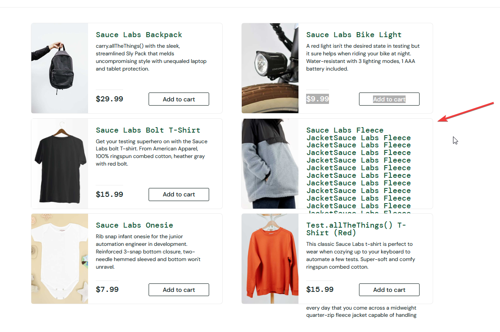

# BR-01: Выход текста за границы карточки товара при длинном названии или описании

- **ID:** BR-01
- **Severity:** Minor
- **Priority:** Medium
- **Окружение:** ОС Microsoft Windows 10 Pro (10.0.19045, сборка 19045), браузер Mozilla Firefox 157.0 (64-разрядный), разрешение 1920×1080 (100%)
- **Предусловие:** Выполнен вход под пользователем `standard_user` / `secret_sauce`.

## Шаги воспроизведения
1. Перейти в основной каталог товаров (`https://www.saucedemo.com/inventory.html`).
2. Открыть инструменты разработчика (`DevTools` - вкладка `Inspector`).
3. Выбрать элемент названия или описания первой карточки товара (`Sauce Labs Backpack`).
4. Добавить к существующему тексту названия ~50 дополнительных символов с пробелами (аналогично проверить для описания товара).

## Ожидаемый результат
Высота карточки адаптируется под объём текста (либо текст аккуратно обрезается многоточием) — текст остаётся строго в пределах карточки товара и не перекрывает соседние элементы страницы.

## Фактический результат
Из-за фиксированной высоты карточки текст выходит за её нижнюю границу, налезает на соседние элементы и перекрывается следующей карточкой товара.

## Вложения

## Комментарий
Дефект воспроизводится как в основном каталоге (`/inventory.html`), так и на детальной странице товара, делая часть текста нечитаемой при длинных названиях или описаниях. На странице подтверждения заказа `Checkout: Overview` (`/checkout-step-two.html`) дефект не воспроизводится — там блок корректно растягивается по высоте.
